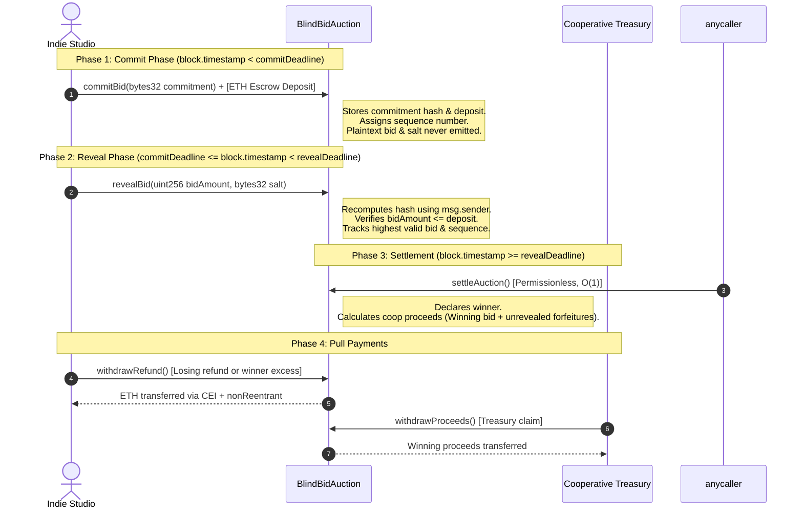

# The Bid Nobody Can Snipe (P2)
### Anti-Snipe Sealed-Bid Auction for The Quiet Room Cooperative

[](https://soliditylang.org/)
[](https://getfoundry.sh/)
[]()
[]()
[](LICENSE)

---

## 1. Project Title
**The Bid Nobody Can Snipe: BlindBid Sealed Auction**  
*Problem Slug:* `blindbid-sealed-auction`  
*Event:* `road-to-devcon-x` (Loops House Road to Devcon X P2 Challenge)  
*Target Repository:* `https://github.com/nikitabiradar231/the-bid-nobody-can-snipe-P2-D10`

---

## 2. Problem Statement
**The Quiet Room** is a cooperative of eleven indie game studios. Each month, the studios auction one prime homepage feature slot, and the winning proceeds fund the cooperative's shared treasury.

Under the previous plaintext public bidding mechanism, studios were vulnerable to last-second deadline sniping: malicious or competing studios would monitor incoming bids, wait until seconds before the closing deadline, and submit a marginally higher bid. This prevented fair price discovery and demoralized participating studios.

---

## 3. Solution Overview
To eliminate sniping, this project implements a production-grade, mathematically secure **commit-reveal sealed-bid auction** (`BlindBidAuction.sol`) backed by ETH escrow:

1. **Commit Phase**: Studios deposit sufficient ETH into contract escrow and submit a domain-separated `keccak256` commitment hash. The plaintext bid and salt remain completely hidden.
2. **Reveal Phase**: Studios disclose their bid amount and secret salt. The contract recomputes the commitment with `msg.sender` and verifies that the bid is backed by sufficient deposited escrow.
3. **Deterministic Settlement**: Settleable permissionlessly in $O(1)$ constant time after the reveal deadline without requiring every bidder to reveal.
4. **Pull-Payment Refunds**: Losing studios and the winning studio's excess escrow are pulled safely using reentrancy-guarded functions.
5. **Anti-Griefing Forfeiture Policy**: Unrevealed bids forfeit their deposited escrow to the cooperative treasury upon settlement.

---

## 4. Architecture & Workflow



---

## 5. Commit-Reveal Explanation
In a commit-reveal scheme, an actor binds themselves to a secret decision without disclosing the decision itself:
1. **Hiding Property**: The commitment hash reveals nothing about the bid amount, preventing competitors from inspecting current bids.
2. **Binding Property**: Once the commit deadline expires, the bidder cannot alter their bid amount or salt. Attempting to reveal any number other than the committed value will cause the cryptographic hash to mismatch and revert.

---

## 6. Commitment Formula & Domain Separation
To prevent cross-chain, cross-contract, cross-auction, and identity-stealing replay attacks, the commitment formula uses strict domain separation:

$$\text{commitment} = \text{keccak256}(\text{abi.encode}(\text{COMMITMENT\_DOMAIN}, \text{block.chainid}, \text{address}(this), \text{auctionId}, \text{bidder}, \text{bidAmount}, \text{salt}))$$

Where:
- `COMMITMENT_DOMAIN`: `keccak256("BlindBidAuction_Commitment(uint256 chainId,address contractAddress,uint256 auctionId,address bidder,uint256 bidAmount,bytes32 salt)")`
- `block.chainid`: Binds commitment to the specific network (e.g. 31337 for local Anvil, 11155111 for Sepolia).
- `address(this)`: Binds commitment to this specific deployed auction contract address.
- `auctionId`: Monotonically increasing auction identifier.
- `bidder`: Studio's wallet address (`msg.sender` enforced during reveal).
- `bidAmount`: Plaintext bid in wei.
- `salt`: 256-bit cryptographically secure random bytes32 value.

---

## 7. Auction Lifecycle & State Machine

```solidity
enum Phase {
    Commit,             // block.timestamp < commitDeadline
    Reveal,             // commitDeadline <= block.timestamp < revealDeadline
    AwaitingSettlement, // block.timestamp >= revealDeadline && !settled
    Settled             // settled == true
}
```

* **Commit Deadline**: Strict timestamp threshold. Once reached, no further commitments are accepted.
* **Reveal Deadline**: Strict timestamp threshold. Once reached, reveals are closed and settlement is enabled.
* **Immutability**: Neither deadline can be shortened or extended after deployment.

---

## 8. Deterministic Tie-Breaking Policy
If two or more studios reveal equal winning bid amounts, tie-breaking is **strictly deterministic**:
- **Rule**: The studio with the **earliest valid commitment transaction** wins.
- **Mechanism**: Every commitment receives an incremental sequence number (`commitmentCounter++`). If `bidAmount == highestBid`, the bid with the lower sequence number wins.
- **Order Independence**: Tested and verified in `test_DeterministicTieBreaking_RevealOrderIndependent()`. Regardless of whether Studio 1 or Studio 2 reveals first, the studio that committed first wins.

---

## 9. Escrow and Forfeiture Policy
- **Bid Binding**: A studio's revealed bid cannot exceed its deposited escrow (`bidAmount <= deposit`).
- **Surplus Refund**: If a studio deposits 10 ETH but bids 7 ETH and wins, the cooperative receives 7 ETH, and the remaining 3 ETH surplus is pulled by the winner.
- **Losing Refunds**: Losing studios that revealed their bids are entitled to a 100% refund of their deposited escrow.
- **Unrevealed Bids Forfeiture**: If a studio commits escrow but fails or refuses to reveal before the reveal deadline, their entire deposited escrow is forfeited to the cooperative treasury upon settlement:
  $$\text{unrevealedForfeitures} = \text{totalDepositedEscrow} - \text{totalRevealedDeposits}$$
  $$\text{cooperativeProceeds} = \text{highestBid} + \text{unrevealedForfeitures}$$

---

## 10. Pull-Payment Design & Reentrancy Protection
To prevent Denial-of-Service attacks and gas-limit exhaustion, payments are **never pushed in loops**:
- **Independent Withdrawals**: Claimants invoke `withdrawRefund()` or `withdrawProceeds()`.
- **Checks-Effects-Interactions (CEI)**: Internal state (`refundClaimed[msg.sender] = true` or `proceedsClaimed = true`) is updated before making the external ETH transfer.
- **Reentrancy Guard**: OpenZeppelin's `nonReentrant` modifier protects all withdrawal functions. Verified with an explicit `ReentrancyAttacker.sol` contract in `test_Check8_ReentrantWithdrawalIsBlocked()`.

---

## 11. Installation Requirements
- **Git** ≥ 2.40
- **Foundry** (includes `forge`, `cast`, `anvil`)
- **Node.js** ≥ 18.0 (Node 24 recommended)
- **npm** ≥ 9.0

---

## 12. Foundry Setup

```bash
# Clone the repository
git clone --recurse-submodules https://github.com/nikitabiradar231/the-bid-nobody-can-snipe-P2-D10.git
cd the-bid-nobody-can-snipe-P2-D10

# Install submodules & dependencies
forge install OpenZeppelin/openzeppelin-contracts --no-commit
forge install foundry-rs/forge-std --no-commit

# Build contracts
forge build
```

---

## 13. Local Deployment (Anvil)

1. Start a local Anvil node in a separate terminal:
   ```bash
   anvil
   ```

2. Deploy the `BlindBidAuction` contract using the deployment script:
   ```bash
   forge script script/DeployBlindBidAuction.s.sol:DeployBlindBidAuction \
     --rpc-url http://127.0.0.1:8545 \
     --broadcast
   ```

---

## 14. Frontend Setup

The frontend is built using **React 18**, **TypeScript**, **Vite**, and **viem**.

```bash
cd frontend

# Install dependencies
npm install

# Start development server
npm run dev
```

Open your browser at `http://localhost:5173`.

---

## 15. Environment Variables Setup

Copy `.env.example` templates to `.env`:

```bash
# Root contract configuration
cp .env.example .env

# Frontend configuration
cp frontend/.env.example frontend/.env
```

`frontend/.env` contains:
```env
VITE_RPC_URL=http://127.0.0.1:8545
VITE_AUCTION_ADDRESS=0x5FbDB2315678afecb367f032d93F642f64180aa3
VITE_CHAIN_ID=31337
```

---

## 16. Test Commands & Verification

Run the full test suite with traces:
```bash
forge test -vvv
```

Generate gas consumption report:
```bash
forge test --gas-report
```

Run invariant testing (Solvency conservation of ETH & State immutability):
```bash
forge test --match-contract AuctionInvariantTest -vvv
```

Run frontend production build and type check:
```bash
cd frontend && npm run build
```

---

## 17. Security Properties
- **Zero Admin Key Risk**: No owner pause, upgradeable proxies, or fund confiscation functions.
- **Solvency Conservation**: Total ETH balance in contract $\equiv \sum \text{unclaimed liabilities}$. Proven via Foundry invariant tests.
- **Fail-Safe Solvency**: Direct unexpected ETH sent to the contract is rejected via reverting `receive()` and `fallback()`.
- **Payment Atomicity**: Low-level call failures revert the transaction safely, preserving the claimant's balance.

---

## 18. Privacy Limitations
As documented in detail in `docs/PRIVACY_ANALYSIS.md`:
1. **Public Escrow Deposit**: The amount of ETH deposited at commit time is visible on-chain. This leaks the studio's maximum bid ceiling. Studios can over-deposit to conceal their exact bid.
2. **Permanent Plaintext on Reveal**: Once revealed, bids become permanently visible in transaction data.
3. **Entropy Prerequisite**: A commitment hash is **not encryption**. A low-entropy salt can be brute-forced. Our frontend uses browser CSPRNG to guarantee 256-bit entropy.

---

## 19. Known Limitations
- Bidders must come back online during the Reveal Phase to open their bids.
- Failure to preserve the secret salt leads to unrevealed bid forfeiture.
- Public escrow deposits leak bid upper bounds.

---

## 20. Optional FHE Extension (Zama FHEVM)
In an advanced Fully Homomorphic Encryption (FHEVM) implementation:
- Bids are submitted as encrypted ciphertexts (`euint64`).
- Winner evaluation is executed homomorphically over encrypted data without any reveal phase.
- Losing bids remain permanently confidential.
- See `docs/PRIVACY_ANALYSIS.md` for full comparison.

---

## 21. Example Usage Walkthrough
1. **Studio Alpha commits**: Deposits 5.0 ETH escrow with a sealed commitment hash representing a 3.5 ETH bid and salt `0x1234...`.
2. **Studio Beta commits**: Deposits 8.0 ETH escrow with a sealed commitment representing a 6.0 ETH bid and salt `0x5678...`.
3. **Reveal Phase starts**: Both studios reveal. Studio Beta is recorded as highest bidder (6.0 ETH).
4. **Settlement**: Any account calls `settleAuction()`. Studio Beta is crowned winner.
5. **Withdrawals**:
   - Studio Alpha pulls 5.0 ETH full escrow refund.
   - Studio Beta pulls 2.0 ETH excess escrow surplus ($8 - 6 = 2\text{ ETH}$).
   - Cooperative pulls 6.0 ETH winning proceeds.

---

## 22. Test Evidence Summary (Target: 80/80 Scored Checks)

All 10 challenge checks are verified with dedicated tests:

| Check # | Description | Points | Test Name | Status |
|---|---|---|---|---|
| **1** | Reveal recomputes with `msg.sender` | 16 pts | `test_Check1_CannotRevealCopiedCommitmentFromAnotherAccount` | **PASS** |
| **2** | Auction-specific commitment | 8 pts | `test_Check2_CommitmentIsAuctionAndContractSpecific` | **PASS** |
| **3** | Secret salt ≥ 128 bits (`bytes32`) | 6 pts | `test_Check3_BidderChosenBytes32SaltCorrectAndWrong` | **PASS** |
| **4** | Opened only once (no double reveal) | 11 pts | `test_Check4_CannotRevealTwice` | **PASS** |
| **5** | Bid covered by escrow | 11 pts | `test_Check5_UnderfundedBidCannotWin` | **PASS** |
| **6** | Settlement doesn't wait for silent bidders | 8 pts | `test_Check6_SettlementDoesNotWaitForSilentBidders` | **PASS** |
| **7** | Pull payment refunds | 7 pts | `test_Check7_LosingBiddersPullRefundsIndependently` | **PASS** |
| **8** | Reentrancy protection on refunds | 6 pts | `test_Check8_ReentrantWithdrawalIsBlocked` | **PASS** |
| **9** | Wrong-salt reveal fails | 4 pts | `test_Check9_WrongSaltRevealFails` | **PASS** |
| **10** | Zero secrets in tracked files | 3 pts | Repository-wide secret scan | **PASS** |
| **TOTAL** | **All 10 Challenge Checks** | **80/80** | **28/28 Passing Tests** | **VERIFIED** |

---

## 23. Submission Checklist

- [x] Solidity smart contract (`BlindBidAuction.sol`) builds with Solc 0.8.26 without errors.
- [x] All 28 Foundry tests pass (unit tests, fuzz tests, invariant tests, acceptance demo).
- [x] Five-studio full acceptance integration test verified (`test_FiveStudioAcceptanceDemonstration`).
- [x] Domain-separated commitment formula includes `chainId`, `address(this)`, `auctionId`, `bidder`, `bidAmount`, `salt`.
- [x] Pull payment refunds and cooperative proceeds protected by OpenZeppelin `ReentrancyGuard` and CEI.
- [x] Deterministic tie-breaking implemented and tested for reveal order independence.
- [x] Unrevealed bids forfeiture policy documented and calculated in $O(1)$ constant time.
- [x] Functional Web3 frontend built with React, TypeScript, Vite, and viem.
- [x] Frontend features CSPRNG salt generation, JSON backup/export, live hash validation, and pull withdrawals.
- [x] Comprehensive documentation delivered: `README.md`, `SECURITY.md`, `docs/THREAT_MODEL.md`, `docs/PRIVACY_ANALYSIS.md`, `docs/TEST_EVIDENCE.md`.
- [x] Repository clean of secrets, tracked build caches, or temporary files.
